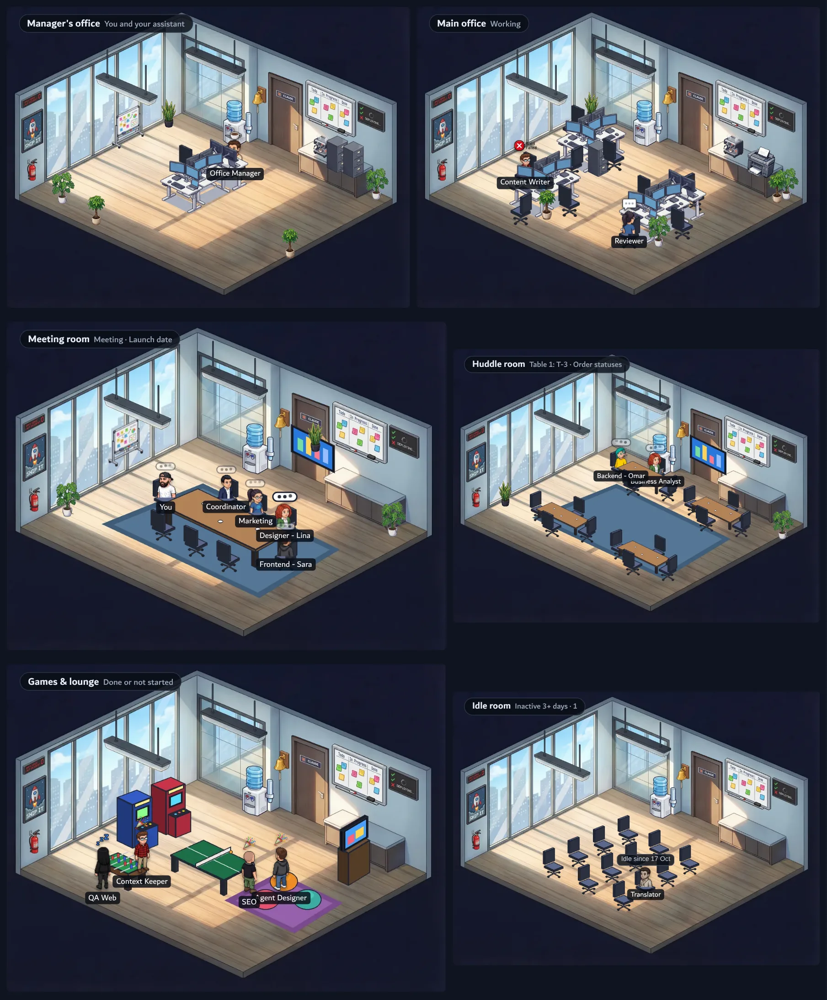
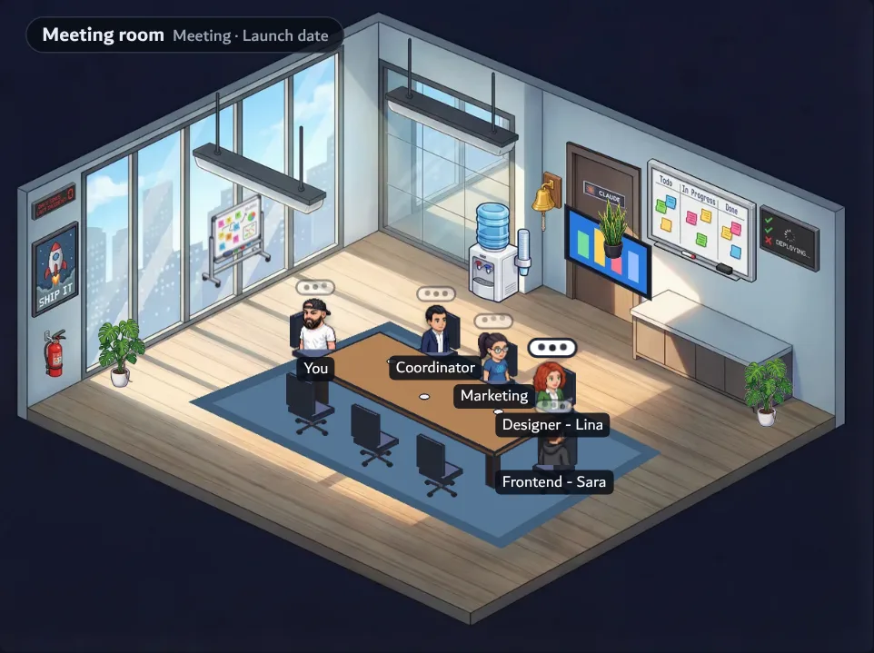
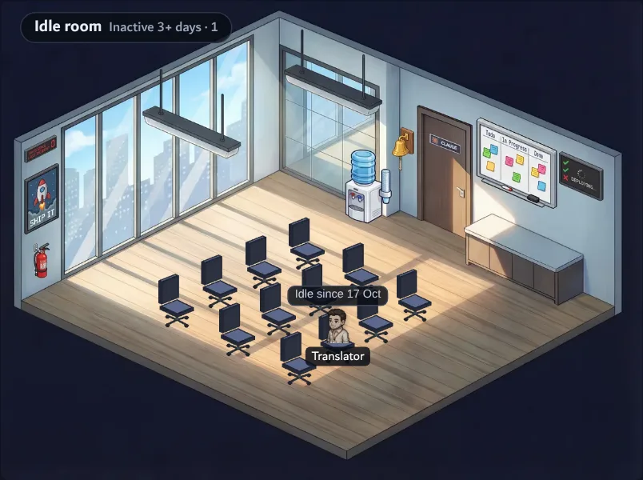
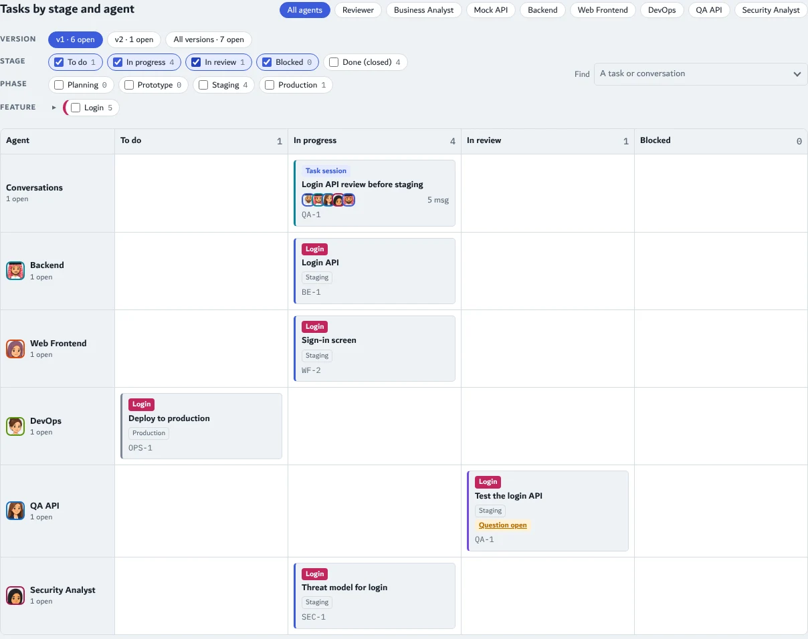
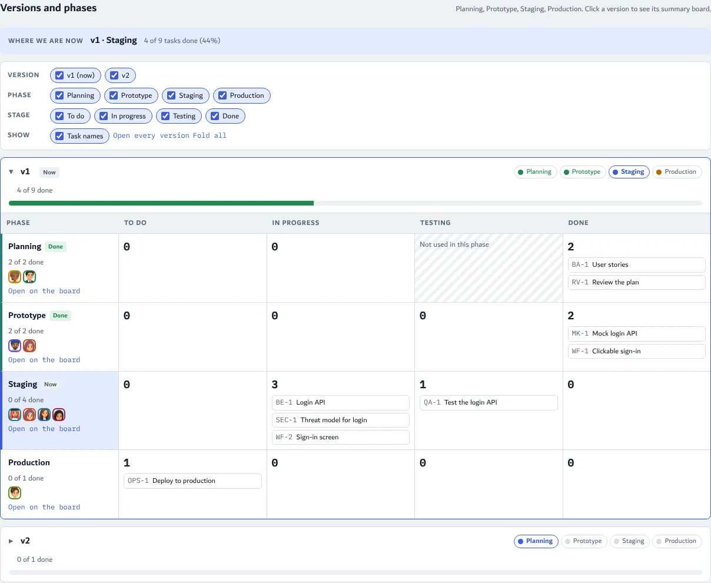

# مكتب الوكلاء (Agent Office)

سكل لـ Claude يبدأ معك أي مشروع أو فكرة بفريق من الوكلاء الأذكياء، ومعه صفحة مكتب تشوف فيها الفريق يشتغل قدامك.

## وش هدف السكل؟

تعطيه فكرتك بكلامك، وهو يبني لك فريق يشتغل عليها. ما يهم نوع المشروع: برنامج، متجر، حملة تسويق، بحث، محتوى، أو أي شغل ثاني.

١. **يجهّز بيئة خاصة للمشروع:** يعرض عليك البيئات اللي عندك، وينصحك بوحدة جديدة لكل مشروع عشان المفاتيح والإعدادات ما تختلط. ولما يحتاج موقع خارجي يقول لك تضيف مفتاح الـ API في البيئة بدل ما تسوي الخطوات بيدك كل مرة، ولو ما تعرف يساعدك تطلعه من كروم.
٢. **مصمم الوكلاء يصمم الفريق معك:** أول وكيل في كل مشروع. أنت توصف وش تبي، وهو يقترح الوكلاء: دور كل واحد وأهدافه ومهامه الأولى وشخصيته وهواياته وشكله. ولو نسيت وكيل مهم ينبهك. ما ينفتح أي وكيل إلا بعد موافقتك، ويبقى المصمم معك طول المشروع يضيف ويعدل.
٣. **المنسق يدير الشغل:** يفتح الوكلاء، ويتابع المهام، ويدير الاجتماعات، ويرجع لك في القرارات الحساسة (فلوس، حذف، البيئة الفعلية، أمان).
٤. **كل شي قدامك في المكتب:** مين يشتغل، مين ينتظرك، وش المهام، ووش يتكلمون فيه.

## قواعد ثابتة

- أسماء الوكلاء **دايماً بالإنقليزي**، وتختار الأسلوب: بالدور بس (`Frontend`) أو الدور مع اسم (`Frontend - Ahmed`).
- قبل ما يستخدم سطح المكتب حقك يستأذن ويسألك وش المجلدات المسموحة، وقت الحاجة بس.
- ينصحك بمتصفح مخصص لـ Claude مع إضافة Claude لما يحتاج أوامر بالمتصفح.
- الخدمات والاستضافات اقتراحات مو إجبار، ويدوّر لك على الأفضل وقت التصميم.
- المفاتيح والأسرار ما تنكتب في الشات ولا في الكود أبداً.

## غرف المكتب

| الغرفة | مين فيها |
|---|---|
| مكتب المدير | أنت ومساعدك (مدير المكتب)، والوكلاء اللي ينتظرونك يجون عندك |
| المكتب الرئيسي | الوكلاء اللي يشتغلون على مكاتبهم |
| غرفة الاجتماعات | أول اجتماع أو محادثة مفتوحة |
| غرفة الطاولات الصغيرة | المحادثات اللي تبدأ والغرفة الكبيرة مشغولة |
| الألعاب والاستراحة | اللي خلصوا أو ما بدأوا |
| غرفة الخاملين | أي وكيل له أكثر من ٣ أيام بدون نشاط، يقعد على كرسي بدون حركة وفوقه "Idle since" والتاريخ، ويرجع لحاله أول ما ينعطى شغل |

غرف العمل والاجتماعات تزيد وتنقص حسب الضغط: كل ١٠ وكلاء يشتغلون ينفتح مكتب جديد، وكل ٤ محادثات زيادة تنفتح غرفة طاولات جديدة، ولما يخف الشغل تتسكر الغرف الزايدة.

<table><tr>
<td></td>
<td></td>
</tr></table>

## التبويبات

- **Office:** الغرف والفريق.
- **Roadmap:** النسخ (v1، v2...) ومراحل كل نسخة وين وصلت (للمشاريع البرمجية).
- **Chat:** كل محادثة بين الوكلاء لها شات خاص، والاجتماعات، والأرشيف.
- **Task board:** لوحة كانبان للمهام حسب الوكيل والمرحلة والميزة.

## طريقة التركيب

١. حمّل مجلد `agent-designer-playbook` وارفعه في Claude من الإعدادات (Settings > Capabilities > Skills)، أو انسخه إلى `~/.claude/skills/`.
٢. احفظ رابط هذا الريبو في ذاكرة مشروعك على إنه "office template repo".
٣. قول لـ Claude: "ابدأ هالفكرة مع مصمم الوكلاء" واكتب فكرتك.

---

# Agent Office

A Claude skill that starts any project or idea with a team of AI agents, plus an office page where you watch that team work.

## What the skill is for

You describe your idea in your own words, and the skill builds a team to work on it. Any kind of project fits: software, a store, a marketing campaign, research, content, or anything else.

1. **A separate environment per project.** It lists your environments and recommends a new one for each project, so keys and settings never mix. When the work needs an outside site, it asks you to add that site's API key to the environment instead of clicking through the same steps every time, and it can walk you through getting the key in Chrome.
2. **The Agent Designer builds the team with you.** It is the first agent of every project. You describe what you want; it proposes the agents: each one's role, goals, first tasks, personality, hobbies and look. It points out agents you may have forgotten. Nothing opens until you accept it, and the designer stays for the whole project to add or change agents.
3. **The Coordinator runs the work.** It opens agents, tracks tasks, runs meetings, and brings sensitive decisions (money, deletion, production, security) to you.
4. **Everything is visible in the office:** who is working, who is waiting for you, the tasks, and what the agents are discussing.

## Fixed rules

- Agent names are **always English**. You pick the style: role only (`Frontend`) or role plus a name (`Frontend - Ahmed`).
- Before using your desktop, the agent asks for permission and which folders it may see, only when it first needs them.
- When browser work comes up, it suggests a browser kept just for Claude, with the Claude extension.
- Services and hosting are suggestions, never requirements; it looks for better options at design time.
- Keys and secrets never go in chat or code.

## Office rooms

| Room | Who is there |
|---|---|
| Manager's office | You and your assistant (the Office Manager); agents waiting for you come here |
| Main office | Agents working at their desks |
| Meeting room | The first open meeting or conversation |
| Huddle room | Conversations that start while the big room is busy |
| Games & lounge | Agents that are done or not started |
| Idle room | Any agent with no activity for more than 3 days sits still on a chair with "Idle since <date>" and comes back as soon as it gets work |

Work and meeting rooms grow and shrink with the load: another main office opens for every 10 working agents, another huddle room for every 4 extra conversations, and the extra rooms close when things calm down.

## Tabs

- **Office:** the rooms and the team.
- **Roadmap:** versions (v1, v2...) and where each one's phases stand (software projects).
- **Chat:** every agent-to-agent conversation has its own chat, plus meetings and an archive.
- **Task board:** a kanban of tasks by agent, stage and feature.

## Install

1. Download the `agent-designer-playbook` folder and upload it in Claude (Settings > Capabilities > Skills), or copy it into `~/.claude/skills/`.
2. Save this repo's link in your project memory as the "office template repo".
3. Tell Claude: "start this idea with the agent designer" and describe your idea.

## What's inside

- `agent-designer-playbook/SKILL.md`: the skill.
- `office/office.html`: the office page template (a claude.ai Artifact with the `db`, `user` and `sample` capabilities).
- `office/SPEC.md`: every requirement of the page and its data layout. `office/README.md`: how to publish it.
- `office/assets/`: rooms, furniture, characters, effects and fonts. `office/tools/`: scripts that draw the meeting, huddle and games room furniture.

## Credits

Office room, furniture, effects and character sprites from [W17ant/Claude-Office](https://github.com/W17ant/Claude-Office) (MIT, see `office/assets/LICENSE-Claude-Office.txt`). Font: Dubai. Screenshots use made-up demo data.
