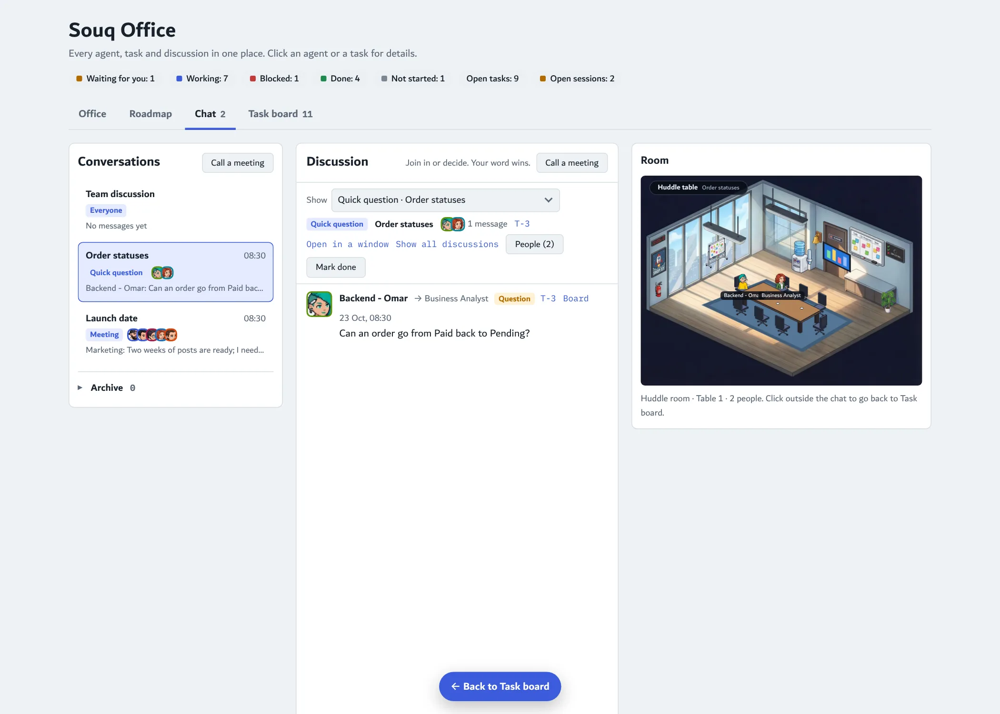

# مكتب الوكلاء

سكل لـ Claude يبني لك فريق وكلاء لأي فكرة، ويعطيك مكتب تشوفهم فيه يشتغلون.

## وش يسوي؟

توصف فكرتك، وهو يمشي معك بهالترتيب:

1. **البيئة:** يجهّز بيئة خاصة للمشروع، ومفاتيح الـ API تنحط فيها.
2. **الفريق:** مصمم الوكلاء يقترح الفريق، وأنت توافق أو ترفض.
3. **الشغل:** المنسق يوزع المهام ويدير الاجتماعات.
4. **المتابعة:** كل شي تشوفه في المكتب.

يناسب أي مشروع: برنامج، متجر، تسويق، بحث، محتوى.

## قواعد ثابتة

- أسماء الوكلاء بالإنقليزي دايماً.
- ما يلمس جهازك إلا بإذنك، وبالمجلدات اللي تحددها.
- القرارات الحساسة (فلوس، حذف، أمان) ترجع لك.
- الخدمات المقترحة اختيارية، مو إجبارية.

## الغرف

| الغرفة | مين فيها |
|---|---|
| مكتب المدير | أنت ومساعدك |
| المكتب الرئيسي | اللي يشتغلون |
| الاجتماعات والطاولات | اللي يتناقشون |
| الاستراحة | اللي خلصوا |
| الخاملين | ٣ أيام بدون نشاط |

غرف العمل والاجتماعات تزيد وتنقص حسب الضغط.

<table><tr>
<td></td>
<td></td>
</tr></table>

## التبويبات

| التبويب | وش فيه |
|---|---|
| Office | الغرف والفريق |
| Roadmap | النسخ ومراحلها |
| Chat | المحادثات وغرفتها بجنبها |
| Task board | لوحة المهام |

## التركيب

1. ارفع مجلد `agent-designer-playbook` في Claude من Settings > Capabilities > Skills.
2. احفظ رابط هذا الريبو في ذاكرة مشروعك.
3. قول لـ Claude: "ابدأ فكرتي مع مصمم الوكلاء".

---

# Agent Office

A Claude skill that builds an AI agent team for any idea, with an office page where you watch them work.

## What it does

You describe your idea, and it walks you through:

1. **Environment:** sets up a separate environment for the project; API keys go there.
2. **Team:** the Agent Designer proposes the agents; you accept or reject each one.
3. **Work:** the Coordinator hands out tasks and runs meetings.
4. **Follow-up:** everything is visible in the office.

It fits any project: software, a store, marketing, research, content.

## Fixed rules

- Agent names are always English.
- It never touches your computer without permission, and only in the folders you allow.
- Sensitive decisions (money, deletion, security) come back to you.
- Suggested services are optional, never required.

## Rooms

| Room | Who is there |
|---|---|
| Manager's office | You and your assistant |
| Main office | Agents at work |
| Meeting and huddle rooms | Agents in a discussion |
| Lounge | Agents that are done |
| Idle room | No activity for 3 days |

Work and meeting rooms grow and shrink with the load.

## Tabs

| Tab | What's in it |
|---|---|
| Office | Rooms and team |
| Roadmap | Versions and their phases |
| Chat | Conversations, with their room beside them |
| Task board | The task kanban |

## Install

1. Upload the `agent-designer-playbook` folder in Claude (Settings > Capabilities > Skills).
2. Save this repo's link in your project memory.
3. Tell Claude: "start my idea with the agent designer".

## What's inside

- `agent-designer-playbook/SKILL.md`: the skill.
- `office/office.html`: the office page template (a claude.ai Artifact with the `db`, `user` and `sample` capabilities).
- `office/SPEC.md`: every requirement of the page and its data layout. `office/README.md`: how to publish it.
- `office/assets/`: rooms, furniture, characters, effects and fonts. `office/tools/`: scripts that draw the meeting, huddle and games room furniture.

## Credits

Office room, furniture, effects and character sprites from [W17ant/Claude-Office](https://github.com/W17ant/Claude-Office) (MIT, see `office/assets/LICENSE-Claude-Office.txt`). Font: Dubai. Screenshots use made-up demo data.
