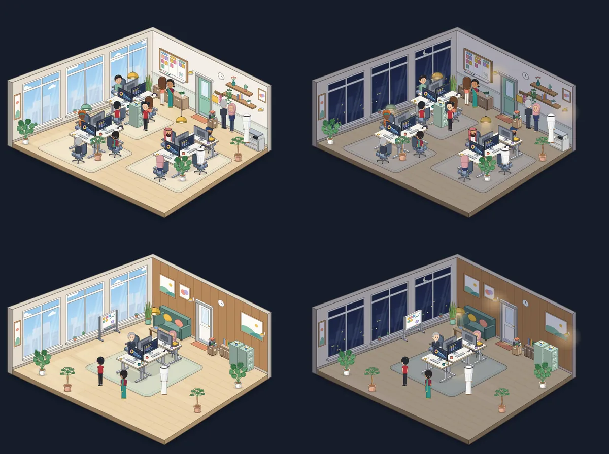
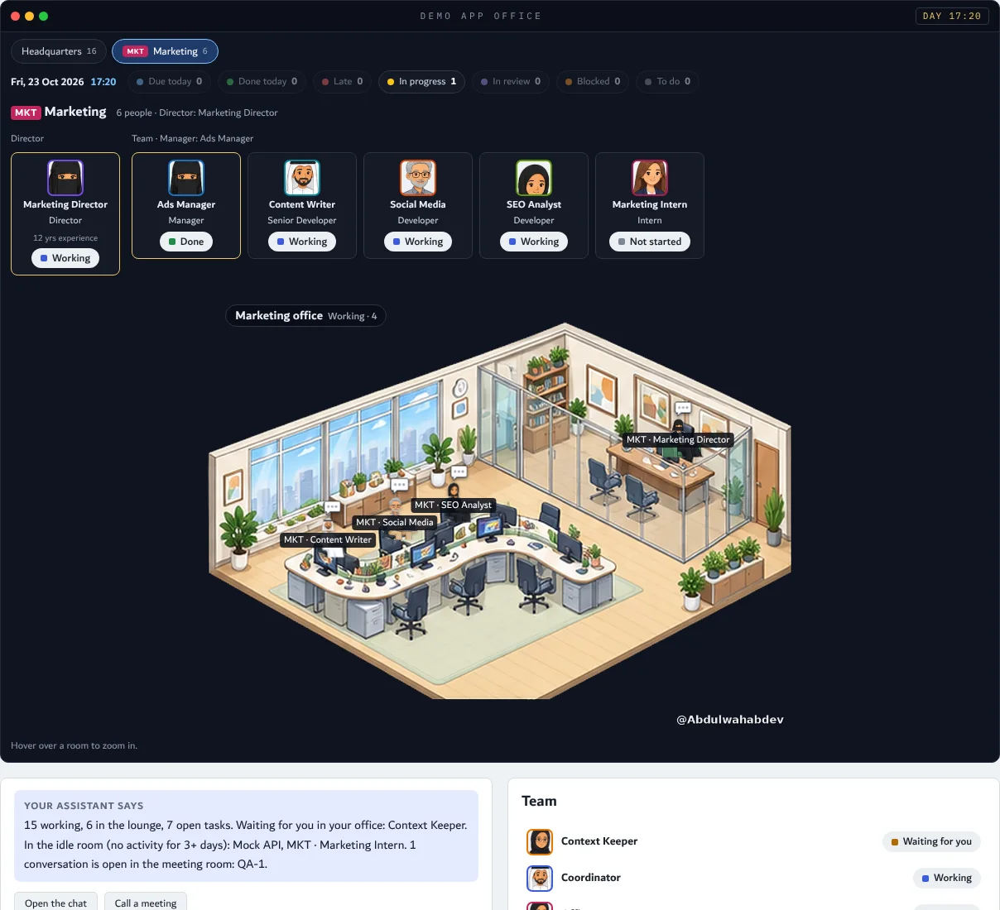
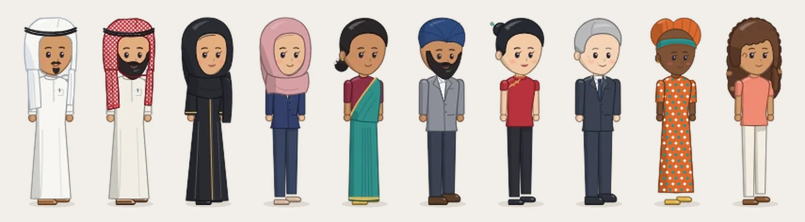

# مكتب الوكلاء

سكل لـ Claude يبني لك فريق وكلاء لأي فكرة، ويعطيك مكتب تشوفهم فيه يشتغلون.

## وش يسوي؟

توصف فكرتك، وهو يمشي معك بهالترتيب:

1. **البيئة:** يجهّز بيئة خاصة للمشروع، ومفاتيح الـ API تنحط فيها.
2. **الفريق:** مصمم الوكلاء يقترح الفريق، وأنت توافق أو ترفض.
3. **الشغل:** المنسق يوزع المهام ويدير الاجتماعات.
4. **المتابعة:** كل شي تشوفه في المكتب.

يناسب أي مشروع: برنامج، متجر، تسويق، بحث، محتوى.

## قواعد ثابتة

- أسماء الوكلاء بالإنقليزي دايماً.
- ما يلمس جهازك إلا بإذنك، وبالمجلدات اللي تحددها.
- القرارات الحساسة (فلوس، حذف، أمان) ترجع لك.
- الخدمات المقترحة اختيارية، مو إجبارية.

## الغرف

| الغرفة | مين فيها |
|---|---|
| مكتب المدير | أنت ومساعدك |
| المكتب الرئيسي | اللي يشتغلون |
| الاجتماعات والطاولات | اللي يتناقشون |
| الاستراحة | اللي خلصوا |
| الخاملين | ٣ أيام بدون نشاط |

غرف العمل والاجتماعات تزيد وتنقص حسب الضغط.

## الأقسام

لما يكبر المشروع، مصمم الوكلاء يقترح أقسام (مثلاً التسويق):

- كل قسم له تبويب وغرف خاصة، وموظفينه بصف أفقي.
- رمز القسم قبل اسم الوكيل: `MKT · Content Writer`.
- مدير قسم (Director) بخبرة ١٠ سنوات وأكثر، وتحته مجموعات لكل وحدة مدير (Manager).
- كل مجموعة فيها سينيور وجونيور ومتدربين.

المسميات من الأصغر للأكبر:
Intern ← Developer / Analyst ← Senior ← Consultant ← Senior Consultant ← Manager ← Director

<table><tr>
<td></td>
<td></td>
</tr></table>

## الشخصيات

١٨ شخصية من ثقافات مختلفة (منها ٨ عربية زيادة)، ومصمم الوكلاء يختار منها لكل وكيل. هذي أفضل ١٠: الشعر ولون القميص يتغيرون، واللبس التقليدي يبقى بألوانه.

كل الشخصيات: [characters-all](docs/images/characters-all.webp). وفيه ٣٠ شخصية ثانية مكتوبة في المولّد وبتنضاف قريب.

## التبويبات

| التبويب | وش فيه |
|---|---|
| Office | الغرف والفريق |
| Roadmap | النسخ ومراحلها |
| Chat | المحادثات وغرفتها بجنبها |
| Task board | لوحة المهام |
| Reviews | المراجعات: قبول، قبول بملاحظات، أو رفض مع التعديلات المطلوبة والمهام الفرعية والشات |
| Team | الهيكل: أنت، ثم المدراء، ثم اللي تحتهم |

## التركيب

1. ارفع مجلد `agent-designer-playbook` في Claude من Settings > Capabilities > Skills.
2. احفظ رابط هذا الريبو في ذاكرة مشروعك.
3. قول لـ Claude: "ابدأ فكرتي مع مصمم الوكلاء".

---

# Agent Office

A Claude skill that builds an AI agent team for any idea, with an office page where you watch them work.

## What it does

You describe your idea, and it walks you through:

1. **Environment:** sets up a separate environment for the project; API keys go there.
2. **Team:** the Agent Designer proposes the agents; you accept or reject each one.
3. **Work:** the Coordinator hands out tasks and runs meetings.
4. **Follow-up:** everything is visible in the office.

It fits any project: software, a store, marketing, research, content.

## Fixed rules

- Agent names are always English.
- It never touches your computer without permission, and only in the folders you allow.
- Sensitive decisions (money, deletion, security) come back to you.
- Suggested services are optional, never required.

## Rooms

| Room | Who is there |
|---|---|
| Manager's office | You and your assistant |
| Main office | Agents at work |
| Meeting and huddle rooms | Agents in a discussion |
| Lounge | Agents that are done |
| Idle room | No activity for 3 days |

Work and meeting rooms grow and shrink with the load.

## Departments

When the project grows, the Agent Designer proposes departments (e.g. Marketing):

- Each department has its own tab and rooms, with its staff in one horizontal row.
- The department code comes before the agent's name: `MKT · Content Writer`.
- A Director (10+ years) leads the department, with a Manager for each group.
- Each group mixes seniors, juniors and interns.

Positions, lowest to highest: Intern → Developer / Analyst → Senior → Consultant → Senior Consultant → Manager → Director.

## Characters

Eighteen characters from different cultures (including eight more Arab looks), and the Agent Designer picks one for each agent. These are the top ten: Hair and shirt colors can change; traditional dress keeps its own colors. The list is in `office/assets/chars/characters.json`.

All of them: [characters-all](docs/images/characters-all.webp). Thirty more are already written in the generator and are coming soon.

## Tabs

| Tab | What's in it |
|---|---|
| Office | Rooms and team |
| Roadmap | Versions and their phases |
| Chat | Conversations, with their room beside them |
| Task board | The task kanban |
| Reviews | Review rounds: approved, approved with notes, or sent back with the changes, sub-tasks and chat |
| Team | The hierarchy: you, then the managers, then their people |

## Install

1. Upload the `agent-designer-playbook` folder in Claude (Settings > Capabilities > Skills).
2. Save this repo's link in your project memory.
3. Tell Claude: "start my idea with the agent designer".

## What's inside

- `agent-designer-playbook/SKILL.md`: the skill.
- `office/office.html`: the office page template (a claude.ai Artifact with the `db`, `user` and `sample` capabilities).
- `office/SPEC.md`: every requirement of the page and its data layout. `office/README.md`: how to publish it.
- `office/assets/`: rooms, furniture, characters, effects and fonts.
- `office/tools/art/`: the generators that draw the rooms, furniture and characters (`build_rooms.py`, `chars.py`), with the shared style in `STYLE.md`.

## Credits

Rooms, furniture and characters are drawn for this repo by the generators in `office/tools/art/`. The small status effects are from [W17ant/Claude-Office](https://github.com/W17ant/Claude-Office) (MIT, see `office/assets/LICENSE-Claude-Office.txt`). Font: Dubai. Screenshots use made-up demo data.
