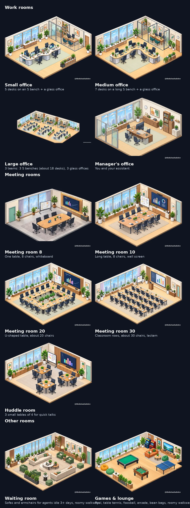
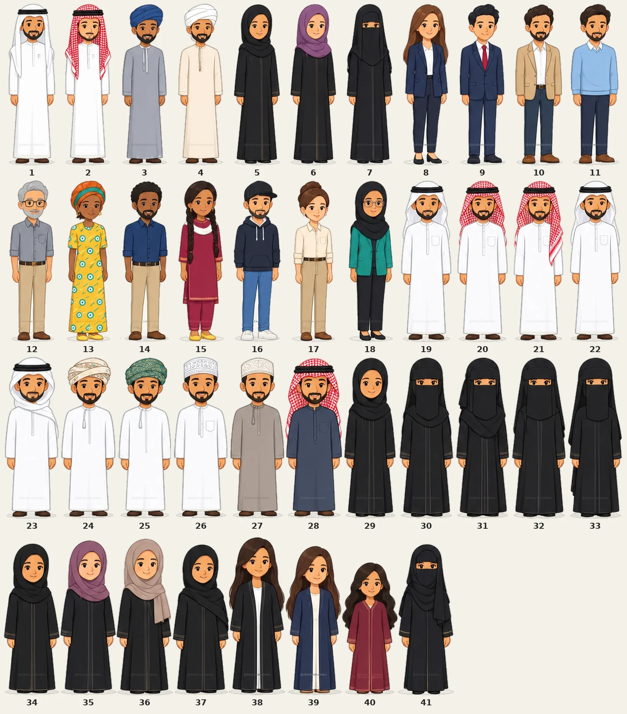
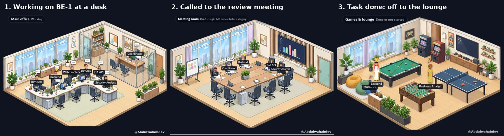
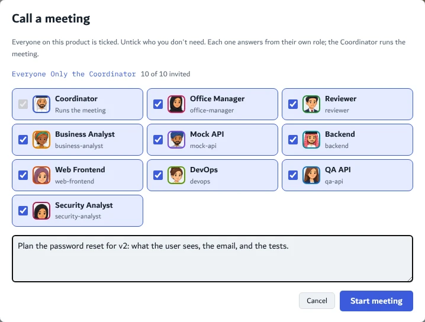

[Go to English description](#agent-office)

# مكتب الوكلاء

سكل لـ Claude يبني لك فريق وكلاء لأي فكرة، ويعطيك مكتب تشوفهم فيه يشتغلون.

## وش يسوي؟

توصف فكرتك، وهو يمشي معك بهالترتيب:

1. **البيئة:** يجهّز بيئة خاصة للمشروع، ومفاتيح الـ API تنحط فيها.
2. **الفريق:** مصمم الوكلاء يقترح الفريق، وأنت توافق أو ترفض.
3. **الشغل:** المنسق يوزع المهام ويدير الاجتماعات.
4. **المتابعة:** كل شي تشوفه في المكتب.

يناسب أي مشروع: برنامج، متجر، تسويق، بحث، محتوى.

## قواعد ثابتة

- أسماء الوكلاء بالإنقليزي دايماً.
- ما يلمس جهازك إلا بإذنك، وبالمجلدات اللي تحددها.
- القرارات الحساسة (فلوس، حذف، أمان) ترجع لك.
- الخدمات المقترحة اختيارية، مو إجبارية.

## الغرف

| الغرفة | مين فيها |
|---|---|
| مكتب المدير | أنت ومساعدك، واللي ينتظرون ردك |
| المكتب الرئيسي | اللي يشتغلون، ومدير القسم في مكتبه الزجاجي |
| الاجتماعات والهادل | اللي يتناقشون |
| الألعاب | اللي خلصوا |
| الانتظار | الخاملين ٣ أيام وأكثر |

كل الغرف تتكرر: لما الغرفة تقرب تمتلي تنفتح نسخة ثانية، ولما يقل العدد تختفي. غرفة الاجتماع تنختار حسب عدد الحضور (١٠ أو ٢٠ أو ٣٠). لما يقعد الوكيل ينرسم بجلسة تناسب لبسه والكرسي اللي قاعد عليه، ولما يمشي يلف حول الطاولات والأثاث. وتقدر تحدد طول كل وكيل من إعدادات شكله.

كل نوع غرفة مرة وحدة، وتحت كل وحدة وش يميزها:

## الأقسام

لما يكبر المشروع، مصمم الوكلاء يقترح أقسام (مثلاً التسويق):

- كل قسم له تبويب وغرف خاصة، وموظفينه بصف أفقي.
- رمز القسم قبل اسم الوكيل: `MKT · Content Writer`.
- مدير قسم (Director) بخبرة ١٠ سنوات وأكثر، وتحته مجموعات لكل وحدة مدير (Manager).
- كل مجموعة فيها سينيور وجونيور ومتدربين.

المسميات من الأصغر للأكبر:
Intern ← Developer / Analyst ← Senior ← Consultant ← Senior Consultant ← Manager ← Director

## الشخصيات

٤١ شخصية من ثقافات مختلفة. تختار وحدة لكل وكيل من صفحته.

## التبويبات

| التبويب | وش فيه |
|---|---|
| Office | الغرف والفريق |
| Roadmap | النسخ ومراحلها |
| Chat | المحادثات وغرفتها بجنبها |
| Task board | لوحة المهام |
| Reviews | المراجعات: قبول، قبول بملاحظات، أو رفض مع التعديلات المطلوبة والمهام الفرعية والشات |
| Team | الهيكل: أنت، ثم المدراء، ثم اللي تحتهم |

## أمثلة حقيقية من الصفحة

**المراحل:** كل نسخة تمشي بأربع مراحل: تخطيط، نموذج، تجريبي، إنتاج. كل مرحلة فيها: لم يبدأ، شغال، اختبار، خلص. وفوق مكتوب وين وصلنا الحين.

**حركة الوكيل:** نفس الوكيل (Backend) يشتغل على مكتبه، ينادونه لاجتماع مراجعة، ولما يخلص مهمته يروح غرفة الألعاب.

**الكانبان:** المهام حسب الوكيل والمرحلة، مع فلتر النسخة والمرحلة.

**طلب اجتماع:** تختار مين يحضر، وتكتب وش تبي تناقش، والمنسق يدير الاجتماع.

**الاجتماع نفسه:** النقاش، والغرفة بجنبه وفيها الحاضرين قاعدين.

## التركيب

1. ارفع مجلد `agent-designer-playbook` في Claude من Settings > Capabilities > Skills.
2. احفظ رابط هذا الريبو في ذاكرة مشروعك.
3. قول لـ Claude: "ابدأ فكرتي مع مصمم الوكلاء".

## الحقوق والاستخدام

كل الرسومات (الغرف والأثاث والشخصيات) والكود من عمل @Abdulwahabdev، والتفاصيل في ملف [LICENSE](LICENSE).

- **الاستخدام المباشر مسموح** في أي مشروع، شخصي أو تجاري، بشرط تبقى الحقوق ظاهرة ورابط هذا الريبو موجود.
- **التعديل أو التحسين في ريبو مستقل** (أو إعادة الرسم أو النشر بنسخة معدلة) لازم قبله إذن مكتوب من صاحب الحساب. اطلبه بفتح Issue هنا.
- كل شخصية عليها تاق صغير `@Abdulwahabdev` يبان بالزوم، والغرف عليها تاق واضح. ممنوع شيلها أو قصها.

---

# Agent Office

A Claude skill that builds an AI agent team for any idea, with an office page where you watch them work.

## What it does

You describe your idea, and it walks you through:

1. **Environment:** sets up a separate environment for the project; API keys go there.
2. **Team:** the Agent Designer proposes the agents; you accept or reject each one.
3. **Work:** the Coordinator hands out tasks and runs meetings.
4. **Follow-up:** everything is visible in the office.

It fits any project: software, a store, marketing, research, content.

## Fixed rules

- Agent names are always English.
- It never touches your computer without permission, and only in the folders you allow.
- Sensitive decisions (money, deletion, security) come back to you.
- Suggested services are optional, never required.

## Rooms

| Room | Who is there |
|---|---|
| Manager's office | You, your assistant, and agents waiting for your answer |
| Main office | Agents at work, and the department head in the glass office |
| Meeting and huddle rooms | Agents in a discussion |
| Games & lounge | Agents that are done |
| Waiting room | No activity for 3 days |

Every room repeats: when one is nearly full a copy opens, and extra copies close when fewer people need them. The meeting room picture follows the meeting size (10, 20 or 30). A seated agent is drawn in a pose that fits its outfit and its seat, and walking agents go around tables and furniture. Each agent's height can be set in its look settings.

Each kind of room once, with what sets it apart:

## Departments

When the project grows, the Agent Designer proposes departments (e.g. Marketing):

- Each department has its own tab and rooms, with its staff in one horizontal row.
- The department code comes before the agent's name: `MKT · Content Writer`.
- A Director (10+ years) leads the department, with a Manager for each group.
- Each group mixes seniors, juniors and interns.

Positions, lowest to highest: Intern → Developer / Analyst → Senior → Consultant → Senior Consultant → Manager → Director.

## Characters

Forty-one characters from different cultures. Pick one for each agent in its page.

## Tabs

| Tab | What's in it |
|---|---|
| Office | Rooms and team |
| Roadmap | Versions and their phases |
| Chat | Conversations, with their room beside them |
| Task board | The task kanban |
| Reviews | Review rounds: approved, approved with notes, or sent back with the changes, sub-tasks and chat |
| Team | The hierarchy: you, then the managers, then their people |

## Real examples from the page

**Stages:** each version goes through four phases: Planning, Prototype, Staging, Production. Each phase has To do, In progress, Testing and Done, and the top line says where the version is now.

**How an agent moves:** the same agent (Backend) works at its desk, gets called to a review meeting, and goes to the lounge when its task is done.

**Kanban:** tasks by agent and stage, filtered by version and phase.

**Calling a meeting:** pick who attends and write what to discuss; the Coordinator runs it.

**The meeting:** the discussion, with its room beside it and the attendees seated.

## Install

1. Upload the `agent-designer-playbook` folder in Claude (Settings > Capabilities > Skills).
2. Save this repo's link in your project memory.
3. Tell Claude: "start my idea with the agent designer".

## What's inside

- `agent-designer-playbook/SKILL.md`: the skill.
- `office/office.html`: the office page template (a claude.ai Artifact with the `db`, `user` and `sample` capabilities).
- `office/SPEC.md`: every requirement of the page and its data layout. `office/README.md`: how to publish it.
- `office/assets/`: rooms, characters, seated poses, effects and fonts.
- `office/tools/cut/`: the scripts that cut the owner's art out of the owner's sheets (nothing is redrawn).

## Rights and use

All art (rooms, furniture, characters) and code are by @Abdulwahabdev; see [LICENSE](LICENSE).

- **Direct use is allowed** in any project, personal or commercial, as long as the credit stays visible and this repo is linked.
- **Changing or improving it in a separate repo** (or redrawing it, or publishing a modified version) needs written permission from the account owner first. Ask by opening an issue here.
- Every character carries a tiny `@Abdulwahabdev` tag that shows when zoomed in, and the rooms carry a clear tag. Do not remove or crop them.

## Credits

The status effect icons are from [W17ant/Claude-Office](https://github.com/W17ant/Claude-Office) (MIT, see `office/assets/LICENSE-Claude-Office.txt`). Font: Dubai. Screenshots use made-up demo data.
