[Go to English](#agent-office-tour)

# جولة مكتب الوكلاء

جولة خطوة بخطوة على السكل، من أول فكرة لين المكتب. في كل صورة الضوء على المكان اللي تطالعه، والسهم وين تضغط.

النسخة التفاعلية (معالج بأزرار وأسهم): [https://abdulwahabdevworkbot-gif.github.io/agent-office/tour/](https://abdulwahabdevworkbot-gif.github.io/agent-office/tour/) (تشتغل بعد تفعيل GitHub Pages من مجلد `docs`). ملفها: [docs/tour/index.html](docs/tour/index.html)

## البداية

### 1. وش هو السكل؟

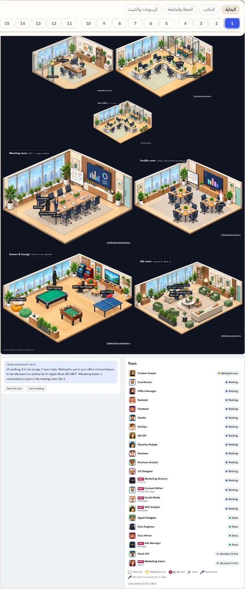

سكل لـ Claude يبني لك فريق وكلاء لأي فكرة، ويعطيك مكتب مرسوم تشوفهم فيه يشتغلون: مين شغال، مين ينتظرك، ومين خلص.

> **وين تطالع:** هذا المكتب. كل شخصية وكيل، وكل غرفة حالة.

- يناسب أي مشروع: برنامج، متجر، تسويق، بحث، محتوى
- كل شي تشوفه بمكان واحد بدل ما تسأل كل وكيل
- القرارات الحساسة ترجع لك دايماً

### 2. قل فكرتك

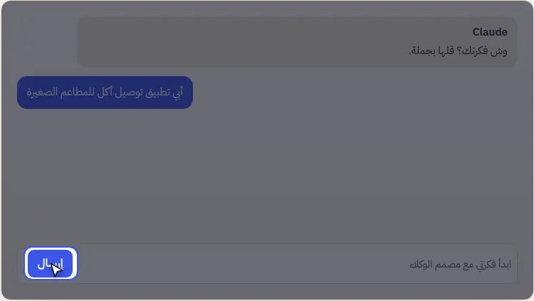

ترفع مجلد السكل في Claude، وبعدين تكتب فكرتك بجملة. السكل يبدأ يمشي معك خطوة خطوة.

> **وين تطالع:** زر الإرسال بعد ما تكتب: «ابدأ فكرتي مع مصمم الوكلاء».

- ما تحتاج تعرف شي تقني
- تقدر تبدأ من فكرة بسيطة وتكبر بعدين

### 3. البيئة والأسئلة

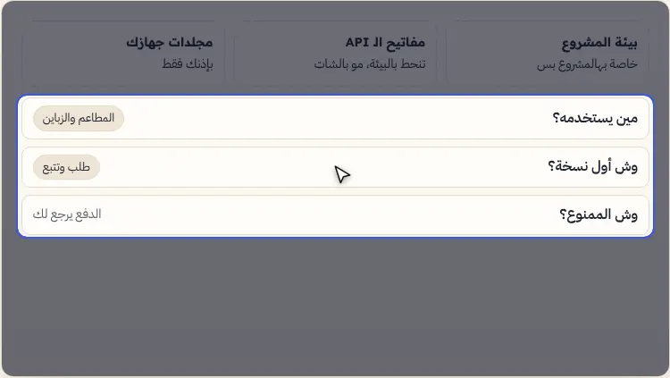

قبل أي شغل، يجهّز بيئة خاصة للمشروع (مفاتيح الـ API تنحط فيها)، ويسألك أسئلة قليلة عن النطاق: مين يستخدمه، وش أول نسخة، ووش الممنوع.

> **وين تطالع:** الأسئلة: كل وحدة لها جواب مقترح تقدر تقبله بضغطة.

- ما يلمس جهازك إلا بإذنك، وبالمجلدات اللي تحددها
- الخدمات المقترحة اختيارية، مو إجبارية

### 4. وافق على الفريق

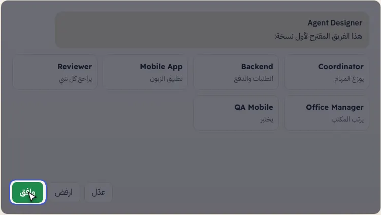

مصمم الوكلاء (Agent Designer) يقترح الفريق: كل وكيل بدوره ومهاراته. أنت توافق أو ترفض أو تعدّل، وبعدها المنسق يوزع المهام.

> **وين تطالع:** زر «وافق»: بعده يفتح المكتب ويبدأ الشغل.

- أسماء الوكلاء بالإنقليزي دايماً
- لما يكبر المشروع ينقسم لأقسام بمدراء

## المكتب

### 5. المكتب يفتح

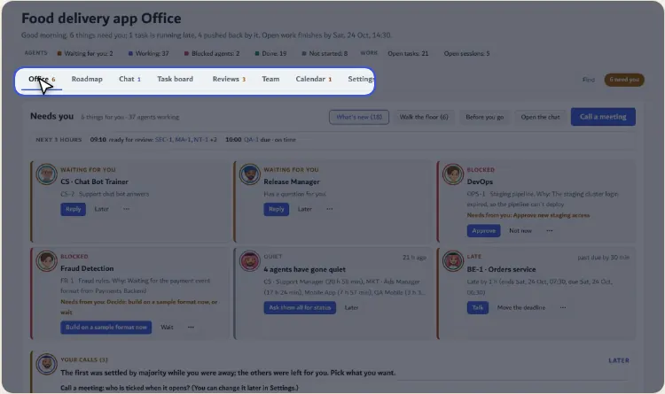

فوق: سطر يقول لك الوضع بكلمة، وأرقام سريعة، وبعدها التبويبات. أي رقم تضغطه يوديك للي وراه.

> **وين تطالع:** التبويبات: المكتب، الخريطة، المحادثة، اللوحة، المراجعات، الفريق، التقويم، الإعدادات.

- الرقم جنب التبويب يقول كم شي ينتظرك فيه
- زر «يحتاجونك» يوديك مباشرة للي يبون ردك

### 6. موجز الصباح

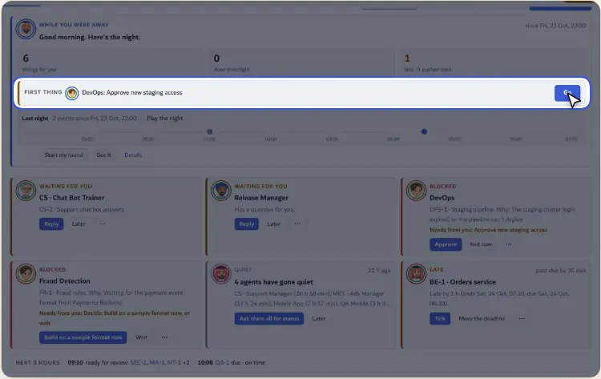

لو غبت ساعات، أول ما ترجع يطلع لك موجز: وش خلص، وش تأخر، ووش «أول شي» تسويه، مع زر «روح» يوديك له.

> **وين تطالع:** سطر «أول شي» وزر «روح» على يمينه.

- ما تضيع وقت تدور من وين تبدأ
- يطلع بس إذا فيه شي يحتاجك فعلاً

### 7. يحتاجونك

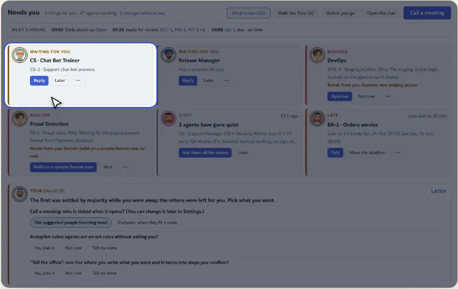

بطاقة لكل وكيل ينتظرك: سؤال، موافقة، أو قرار. الزر الأساسي بالبطاقة هو الجواب المقترح.

> **وين تطالع:** البطاقة الأولى وزر «رد».

- المحظور يقول لك السبب ووش المطلوب منك بالضبط
- «لاحقاً» يخفيها لين وقت تختاره

### 8. الغرف والشخصيات

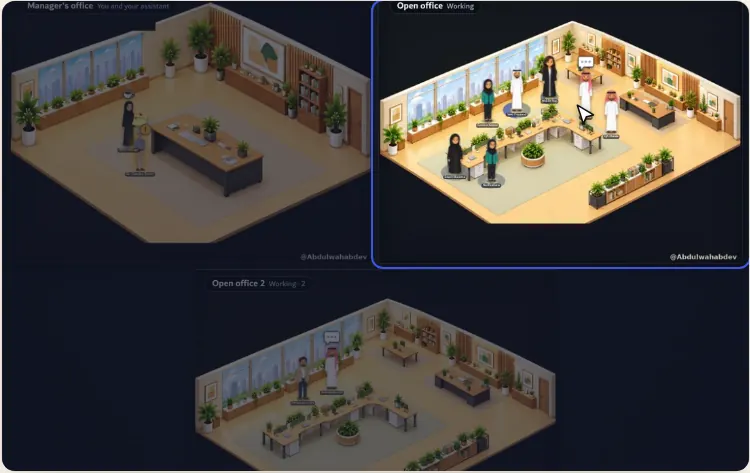

كل وكيل يقعد بالغرفة اللي تناسب حالته: اللي يشتغلون بالمكتب الرئيسي، اللي ينتظرونك بمكتب المدير، واللي خلصوا بغرفة الألعاب. الفقاعة فوق الراس تعني إنه يتكلم.

> **وين تطالع:** المكتب المفتوح: هنا اللي شغالين الحين.

- الغرف تتكرر لما تمتلي وتختفي لما تفضى
- اضغط أي شخصية تفتح صفحتها

### 9. جولة على المكتب

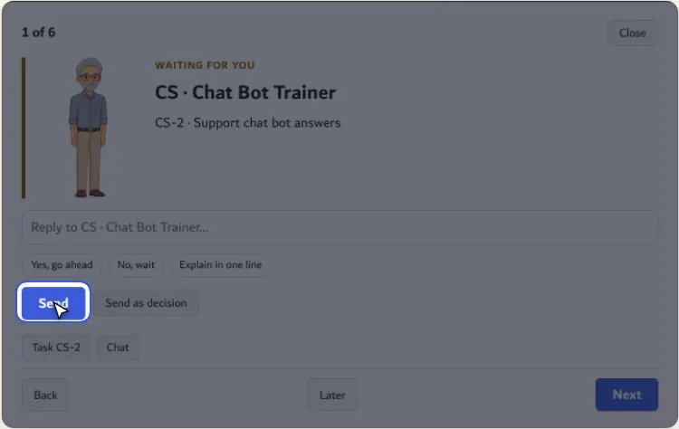

«امشِ بالمكتب» يمرّك على اللي يحتاجونك واحد واحد، مثل مدير يمر على المكاتب.

> **وين تطالع:** زر البداية بأسفل النافذة.

- ترد على الكل بدقايق
- ما يفوتك أحد

### 10. صفحة الوكيل

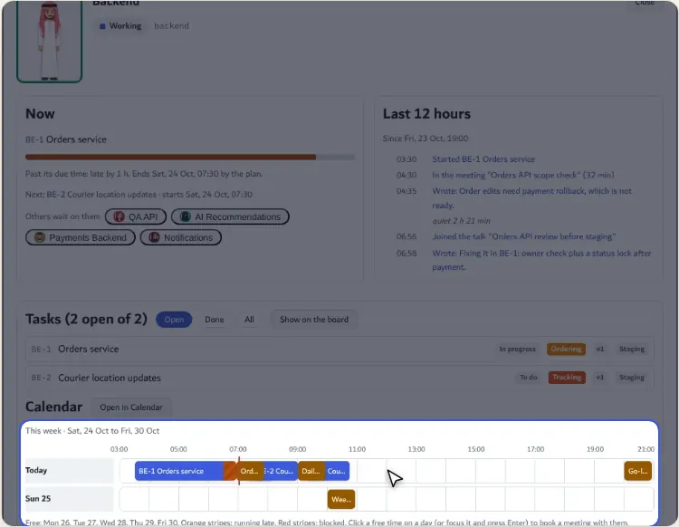

كل شي عن وكيل واحد: وش يسوي الحين، وش بعده، ساعاته بالأسبوع على خط زمني، ومهامه بالترتيب.

> **وين تطالع:** خط اليوم: كل مستطيل مهمة أو اجتماع بوقته.

- تشوف متى يفضى قبل لا تعطيه شي جديد
- تختار شكله وطوله من نفس الصفحة

## الخطة والمتابعة

### 11. التقويم

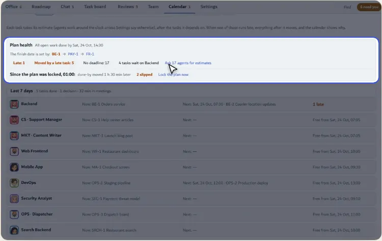

كل مهمة تاخذ مدتها بعد المهام اللي تعتمد عليها. لو وحدة تأخرت، كل اللي بعدها يتحرك، والتقويم يقول لك ليه.

> **وين تطالع:** «صحة الخطة»: متى يخلص كل شي، ومين يحدد الموعد.

- تعرف موعد النهاية الحقيقي
- تقفل الخطة وتشوف وش انزاح من بعدها

### 12. حجز الغرف

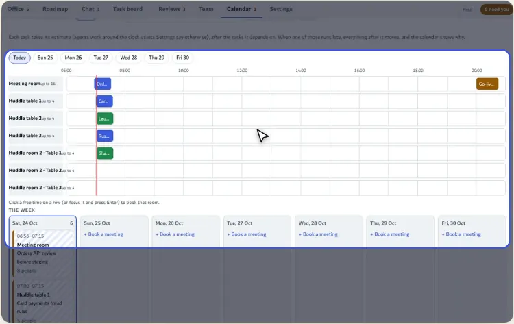

نفس التقويم بس للغرف: كل غرفة اجتماع ومتى محجوزة، عشان ما يتضارب اجتماعين.

> **وين تطالع:** صفوف الغرف وأوقات الحجز.

- الاجتماع ياخذ أصغر غرفة تكفي الحضور

### 13. ادعُ لاجتماع

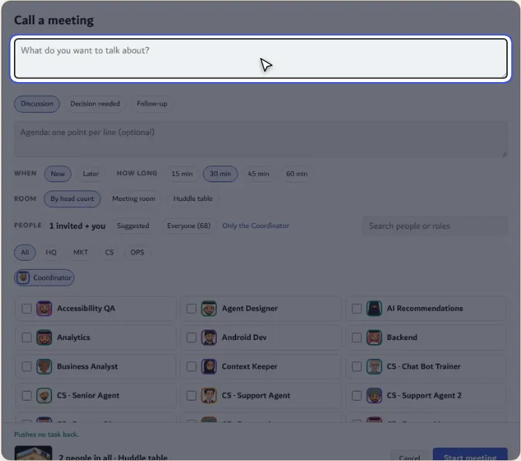

تكتب الموضوع، وهو يقترح الحضور المناسبين، ويختار الغرفة حسب العدد (١٠ أو ٢٠ أو ٣٠).

> **وين تطالع:** خانة الموضوع فوق.

- الشخصيات تمشي للغرفة وتقعد
- الملخص يرجع لك بعد الاجتماع

### 14. المحادثة

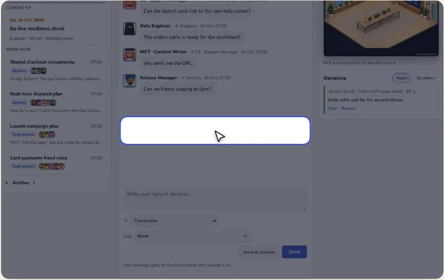

تكلم أي وكيل أو مجموعة، والغرفة اللي هم فيها تبان جنب المحادثة.

> **وين تطالع:** خانة الكتابة.

- كل محادثة مربوطة بمهمتها

### 15. لوحة المهام

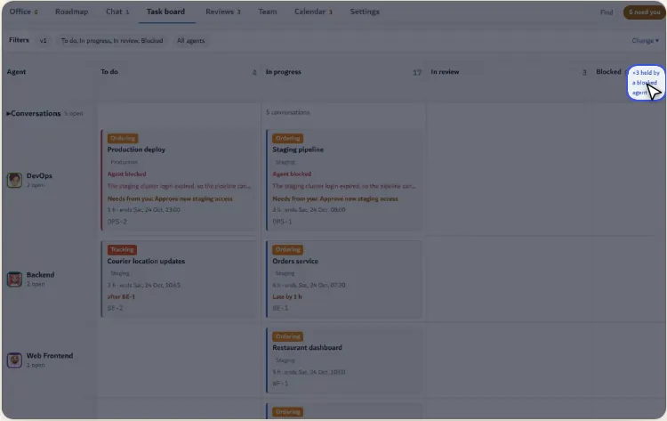

أعمدة المهام من «ما بدأ» لين «خلص». المهام المتوقفة بسبب وكيل محظور تتعلّم، وتقدر تصفّيها بضغطة.

> **وين تطالع:** «+N متوقفة»: يعرض بس المهام اللي ماسكها وكيل محظور.

- تعرف وش اللي يعطّل الشغل كله
- كل رقم زر يصفي اللوحة

### 16. الخريطة

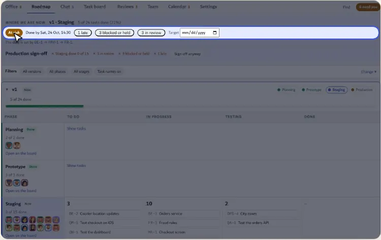

كل نسخة تمشي بأربع مراحل: تخطيط، نموذج، تجريبي، إنتاج. وفوق توقع متى توصل كل مرحلة.

> **وين تطالع:** سطر التوقع.

- تشوف المشروع كله بنظرة
- المراحل الطويلة تنطوي وتفتح

### 17. التوقيع على المرحلة

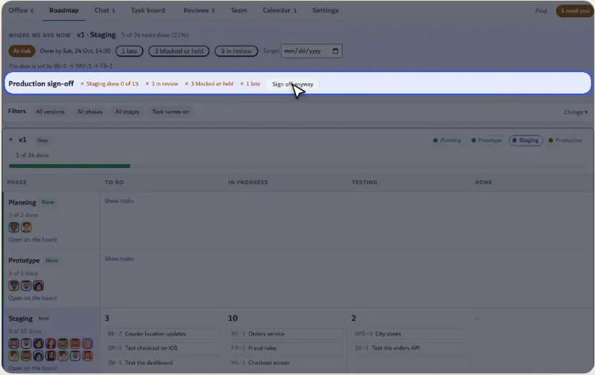

المرحلة ما تنقفل إلا بتوقيعك. لو فيه شي ناقص يقول لك، وتقدر توقّع على مسؤوليتك بضغطتين.

> **وين تطالع:** سطر التوقيع وزره.

- ما ينتقل شي للإنتاج بدون موافقتك

### 18. المراجعات

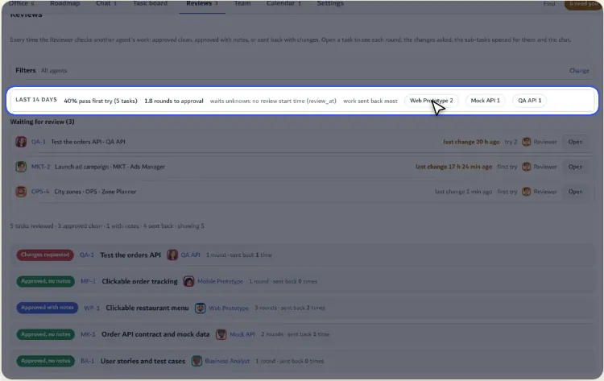

قبول، قبول بملاحظات، أو رفض مع التعديلات المطلوبة. سطر الصحة يقول كم تنتظر المراجعة بالمتوسط.

> **وين تطالع:** سطر صحة المراجعات.

- المراجع وكيل مستقل، مو نفس اللي سوّى الشغل

### 19. الفريق

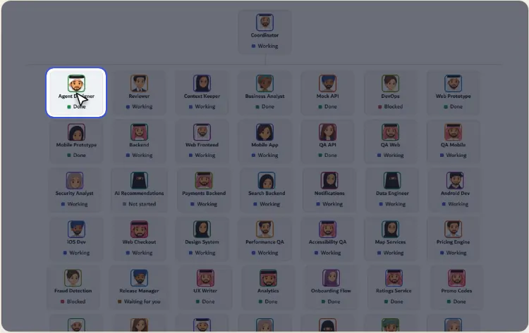

الهيكل: أنت فوق، بعدين المدراء، وتحتهم فرقهم. الشرائح فوق تبرز المحظورين أو الهاديين.

> **وين تطالع:** Agent Designer: اللي صمم الفريق.

- المسميات من Intern لين Director

### 20. الإعدادات

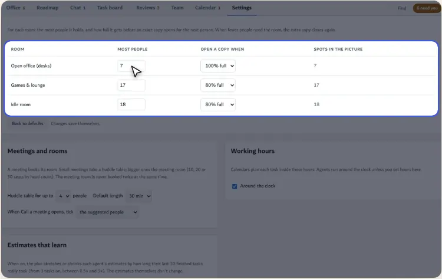

ساعات العمل، قواعد الغرف وأحجامها، ومين يقدر يعدّل. التغيير ينحفظ لحاله.

> **وين تطالع:** قواعد الغرف.

- اللي يشوف بس ما يقدر يغيّر

### 21. وش الجديد

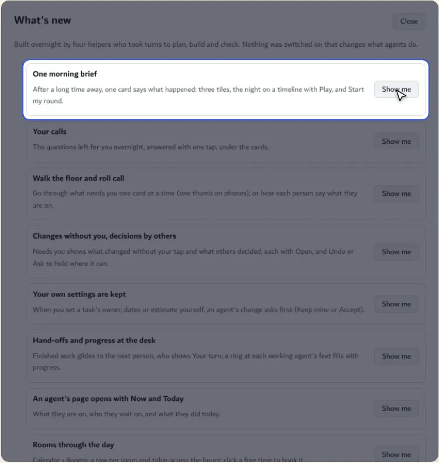

كل ما تغير شي بالصفحة يطلع هنا بسطر، مع زر يوديك له مباشرة.

> **وين تطالع:** أول سطر وزره.

- تعرف التحديثات بدون ما تقرا ملفات

### 22. على الجوال

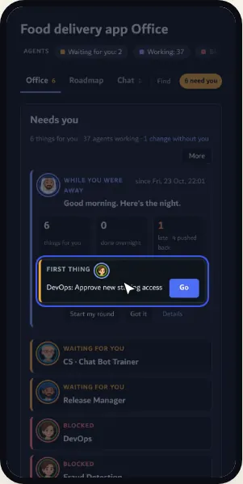

نفس المكتب على الجوال وبالوضع الداكن: البطاقات تتكدس، والتبويبات تنسحب، وزر الرجوع تحت.

> **وين تطالع:** «أول شي» واضح من أول شاشة.

- تتابع وأنت برا

## الرسومات والتثبيت

### 23. الرسومات

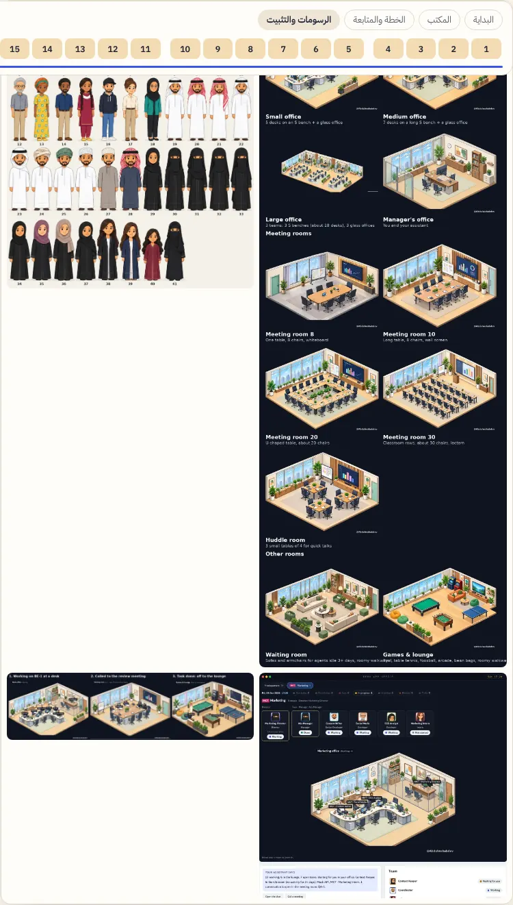

كل الغرف والشخصيات (٤١ شخصية من ثقافات مختلفة) والحركات مقصوصة من لوحات @Abdulwahabdev الأصلية، وما فيه شي معاد رسمه.

> **وين تطالع:** الغرف، الشخصيات، القسم، والحركات.

- الجلسة تتغير حسب اللبس والكرسي
- الشخصية تلف حول الأثاث لما تمشي

### 24. التثبيت

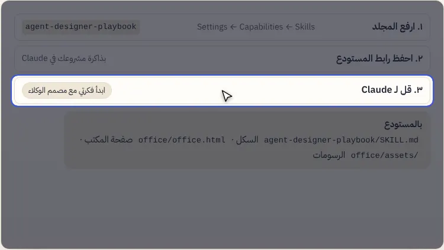

ثلاث خطوات وتبدأ.

> **وين تطالع:** الخطوة الثالثة: الجملة اللي تبدأ فيها.

- الرسومات للسكل بشرط ذكر @Abdulwahabdev (شوف LICENSE)

---

# Agent Office tour

A step-by-step tour of the skill, from the first idea to the office. In each picture the light is on what to look at, and the arrow is where to click.

Interactive version (a wizard with buttons and arrow keys): [https://abdulwahabdevworkbot-gif.github.io/agent-office/tour/](https://abdulwahabdevworkbot-gif.github.io/agent-office/tour/) (works once GitHub Pages serves the `docs` folder). Source: [docs/tour/index.html](docs/tour/index.html)

## Getting started

### 1. What is it?

A Claude skill that builds an agent team for any idea, and gives you a drawn office where you watch them work: who is busy, who is waiting on you, and who is done.

> **Where to look:** This is the office. Each character is an agent, each room is a state.

- Fits any project: software, a store, marketing, research, content
- See everything in one place instead of asking each agent
- Sensitive calls always come back to you

### 2. Say your idea

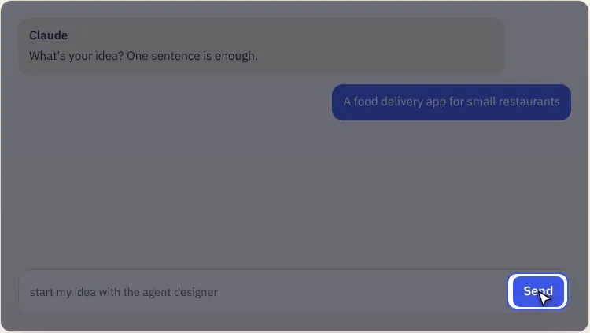

Upload the skill folder to Claude, then describe your idea in one sentence. The skill walks you through the rest.

> **Where to look:** The send button, after typing “start my idea with the agent designer”.

- No technical knowledge needed
- Start small and grow later

### 3. Environment and questions

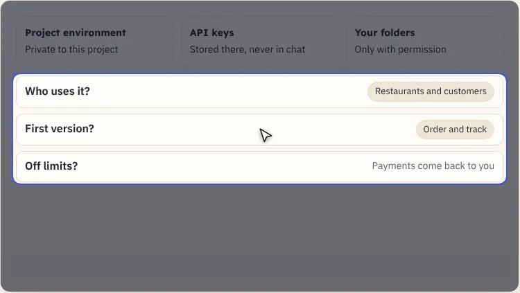

Before any work it sets up a private environment for the project (API keys live there) and asks a few scope questions: who uses it, what the first version is, and what is off limits.

> **Where to look:** The questions: each has a suggested answer you can accept in one tap.

- It never touches your computer without permission, and only in folders you choose
- Suggested services are optional

### 4. Approve the team

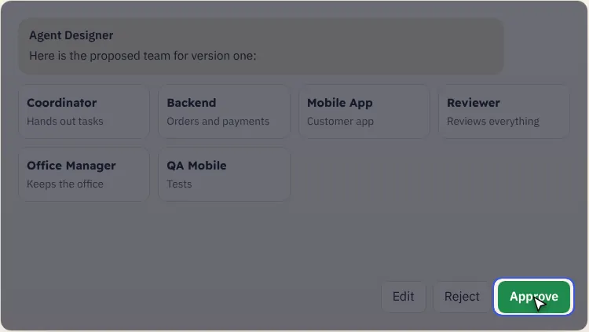

The Agent Designer proposes the team, each agent with a role and skills. You approve, reject or edit, then the Coordinator hands out tasks.

> **Where to look:** The Approve button: the office opens and work starts.

- Agent names are always in English
- Bigger projects split into departments with managers

## The office

### 5. The office opens

At the top: one line on how things stand, quick counts, then the tabs. Any count you tap takes you to what is behind it.

> **Where to look:** The tabs: Office, Roadmap, Chat, Task board, Reviews, Team, Calendar, Settings.

- The number by a tab is what waits for you there
- “need you” jumps straight to the ones waiting on you

### 6. Morning brief

After hours away, a brief greets you: what finished, what slipped, and the “first thing” to do, with a Go button that takes you there.

> **Where to look:** The “First thing” line and its Go button.

- No hunting for where to start
- Shows only when something really needs you

### 7. Needs you

One card per agent waiting on you: a question, an approval or a decision. The main button is the suggested answer.

> **Where to look:** The first card and its Reply button.

- Blocked cards say why and exactly what they need from you
- “Later” hides it until a time you pick

### 8. Rooms and characters

Each agent sits in the room that matches their state: working in the open office, waiting on you in the manager's office, done in the games room. A bubble means they are talking.

> **Where to look:** The open office: everyone working right now.

- Rooms copy themselves when full and vanish when empty
- Tap any character to open their page

### 9. Walk the floor

“Walk the floor” takes you past everyone who needs you, one by one, like a manager walking the desks.

> **Where to look:** The start button at the bottom of the window.

- Answer everyone in minutes
- Nobody gets missed

### 10. Agent page

Everything about one agent: what they do now, what is next, their week on a timeline, and their tasks in order.

> **Where to look:** The day lane: each bar is a task or meeting at its time.

- See when they are free before giving more
- Pick their look and height from the same page

## Plan and follow up

### 11. Calendar

Each task takes its estimate after the tasks it depends on. When one runs late, everything after it moves, and the calendar says why.

> **Where to look:** “Plan health”: when everything finishes, and which chain sets the date.

- Know the real finish date
- Lock the plan and see what moved since

### 12. Room bookings

The same calendar for rooms: each meeting room and when it is booked, so two meetings never clash.

> **Where to look:** The room rows and their bookings.

- A meeting takes the smallest room that fits

### 13. Call a meeting

Type the topic; it suggests who should attend and picks a room by size (10, 20 or 30).

> **Where to look:** The topic box at the top.

- Characters walk to the room and sit
- A summary comes back afterwards

### 14. Chat

Talk to any agent or group, with the room they are in shown beside the chat.

> **Where to look:** The message box.

- Each conversation is tied to its task

### 15. Task board

Columns from not started to done. Tasks held up by a blocked agent are marked and can be filtered in one tap.

> **Where to look:** “+N held”: shows only tasks held by a blocked agent.

- See what is holding everything up
- Every count is a filter button

### 16. Roadmap

Each version moves through four stages: planning, prototype, beta, production, with a forecast of when each lands.

> **Where to look:** The forecast line.

- The whole project at a glance
- Long stages fold and unfold

### 17. Stage sign-off

A stage closes only with your sign-off. If something is missing it says so, and you can sign anyway with two taps.

> **Where to look:** The sign-off line and its button.

- Nothing reaches production without you

### 18. Reviews

Accept, accept with notes, or send back with the changes needed. The health line shows how long reviews wait.

> **Where to look:** The review health line.

- The reviewer is a separate agent, not the author

### 19. Team

The structure: you on top, then managers, then their teams. The chips at the top highlight who is blocked or quiet.

> **Where to look:** Agent Designer: the one who designed the team.

- Titles run from Intern to Director

### 20. Settings

Work hours, room rules and sizes, and who can edit. Changes save on their own.

> **Where to look:** The room rules.

- Viewers can look but not change

### 21. What's new

Every change to the page shows up here as one line, with a button that takes you to it.

> **Where to look:** The first line and its button.

- Learn about updates without reading files

### 22. On your phone

The same office on a phone, in dark mode: cards stack, tabs scroll, and the back button sits at the bottom.

> **Where to look:** “First thing” is visible on the first screen.

- Follow along when you are out

## Art and install

### 23. The art

Every room, character (41, from many cultures) and move is cut from @Abdulwahabdev's original sheets. Nothing is redrawn.

> **Where to look:** Rooms, characters, a department, and moves.

- The seated pose follows the outfit and chair
- Characters walk around furniture

### 24. Install

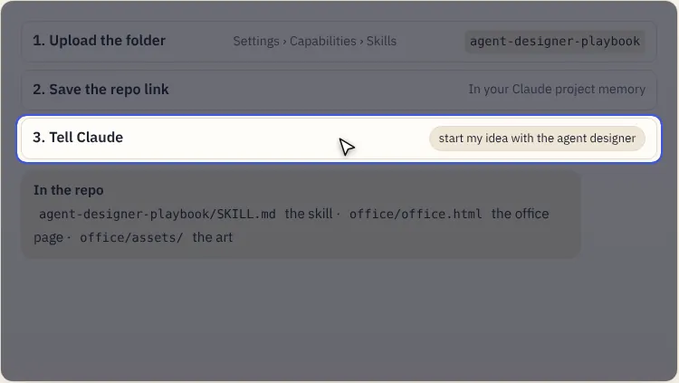

Three steps and you are in.

> **Where to look:** Step three: the sentence that starts it all.

- Art may be used with credit to @Abdulwahabdev (see LICENSE)

---

Art and characters: @Abdulwahabdev. Every piece is cut from the original sheets. See [LICENSE](LICENSE).
